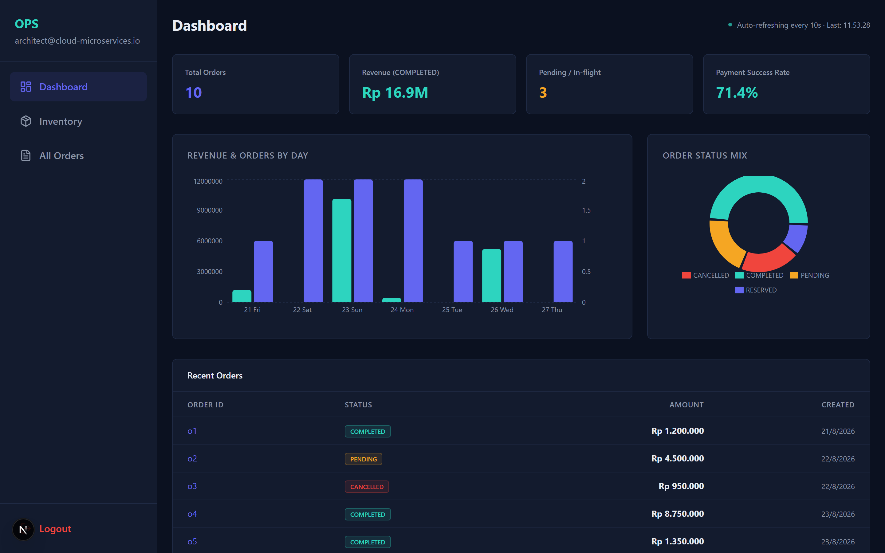
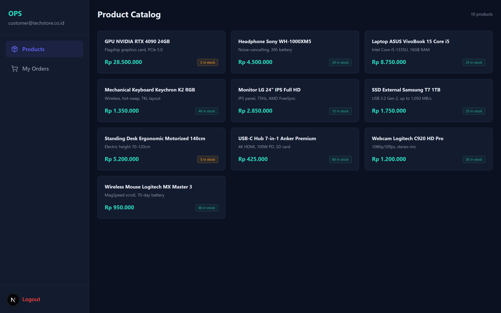
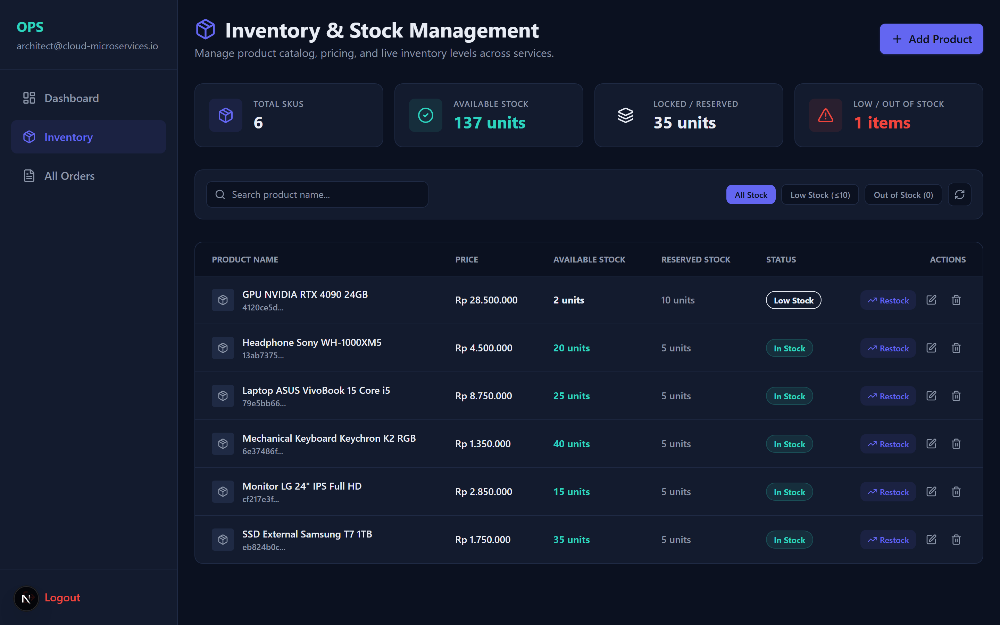

# Order Processing System - Frontend

Web application modern Next.js untuk **Customer** dan **Admin** pada Order Processing System. Frontend terhubung ke Order Service (API Gateway) melalui REST API, terintegrasi dengan Payment Gateway Midtrans, dan menampilkan update status pemrosesan Saga secara real-time melalui WebSocket.

Backend terkait: [order-processing-system_backend](https://github.com/Salman-artz/order-processing-system_backend).

---

## 📸 Antarmuka Sistem & Screenshots

<p align="center">
  
  <br/>
  <em>Dashboard Monitoring Real-Time Metrik Pesanan & Konversi Status Order</em>
</p>

<details open>
<summary><strong>Lihat Antarmuka Fitur Lainnya ▾</strong></summary>

| Halaman | Preview Antarmuka |
|---|---|
| **Customer Storefront**<br/>Katalog produk hardware & alur pembuatan pesanan real-time. |  |
| **Saga Execution Timeline**<br/>Audit log langkah transaksi Saga (Pending, Reserved, Paid, Completed, Cancelled). |  |
| **Inventory & Stock Reservation**<br/>Manajemen stok produk, alokasi reserved stock, dan pencegahan race condition. |  |

</details>

---

## Status & Fitur Utama

- **Customer Portal**:
  - Register dan Login dengan JWT stateless authentication.
  - Katalog produk interaktif dengan ketersediaan stok live.
  - Pembuatan pesanan (Checkout).
  - Riwayat pesanan & detail pesanan lengkap dengan resolusi nama produk.
  - **Integrasi Payment Gateway Midtrans Snap**: Pembayaran via QRIS, GoPay, BCA/Mandiri Virtual Account, & Kartu Kredit.
  - **Saga Status Timeline**: Visualisasi interaktif stepper status (`PENDING` $\rightarrow$ `RESERVED` $\rightarrow$ `AWAITING_PAYMENT` $\rightarrow$ `COMPLETED` / `CANCELLED`).
  - Update realtime via WebSocket tanpa perlu refresh halaman.

- **Admin Portal**:
  - **Dashboard & Analitik**: KPI Ringkasan revenue, total pesanan, dan grafik performa order.
  - **Inventory & Stock Management (`/admin/inventory`)**:
    - Tambah produk baru (*Create SKU*).
    - Edit nama dan harga barang.
    - **Fitur Restock Stok**: Tambah stok unit cepat (+5, +10, +25, +50) atau input kustom.
    - Hapus produk dari katalog (*Delete*).
    - Metrik live: Total SKUs, Available Stock, **Locked / Reserved Stock (Terkunci Saga)**, dan Low-Stock alert.
  - **Monitoring Seluruh Pesanan (`/admin/orders`)**: Audit trail log eksekusi Saga per transaksi.

---

## Tech Stack

| Area | Teknologi | Keterangan |
|---|---|---|
| **Framework** | Next.js 16 (App Router) | React Server & Client Components |
| **Bahasa** | TypeScript | Strict type safety |
| **Styling** | Tailwind CSS v4 & Lucide Icons | Modern, clean, and responsive UI |
| **HTTP Client** | Axios | Request interceptor & JWT token injection |
| **State & Fetching** | TanStack Query v5 & Zustand | Client caching & reactive state |
| **Form Validation** | React Hook Form + Zod | Schema-based client validation |
| **Real-time Push** | Native WebSockets | Live Saga progression broadcast |
| **Notification** | Sonner | Interactive toast alerts |
| **Containerization** | Docker (Multi-stage) & Compose | Optimized standalone production build |

---

## Menjalankan Local Development

```bash
# 1. Install dependencies
npm install

# 2. Salin file konfigurasi environment
Copy-Item .env.local.example .env.local

# 3. Jalankan development server
npm run dev
```

Buka [http://localhost:3000](http://localhost:3000).

Konfigurasi `.env.local` default:
```env
NEXT_PUBLIC_API_BASE_URL=http://localhost:8080/api/v1
NEXT_PUBLIC_WS_URL=ws://localhost:8083/ws
NEXT_PUBLIC_USE_MOCK=false
```

---

## Menjalankan dengan Docker
lib/
  api/client.ts           # Axios instance & token interceptor
  hooks/useOrderSocket.ts # WebSocket listener hook untuk real-time update
  store/useAuthStore.ts   # State autentikasi Zustand

---

## Struktur Direktori

```text
app/
  (auth)/login/           # Halaman Login Customer & Admin
  (auth)/register/        # Halaman Registrasi Customer
  admin/dashboard/        # KPI Metrik & Analitik Admin
  admin/inventory/        # Manajemen Produk & Restock Stok Admin
  admin/orders/           # Daftar & Detail Monitoring Pesanan Admin
  customer/products/      # Katalog Produk & Checkout Pesanan
  customer/orders/        # Riwayat & Detail Pesanan (Midtrans Snap Payment)
components/
  SagaTimeline.tsx        # Komponen visualisasi stepper Saga
  Sidebar.tsx             # Navigasi sidebar dinamis sesuai Role
lib/
  api/client.ts           # Axios instance & token interceptor
  hooks/useOrderSocket.ts # WebSocket listener hook untuk real-time update
  store/useAuthStore.ts   # State autentikasi Zustand
```
