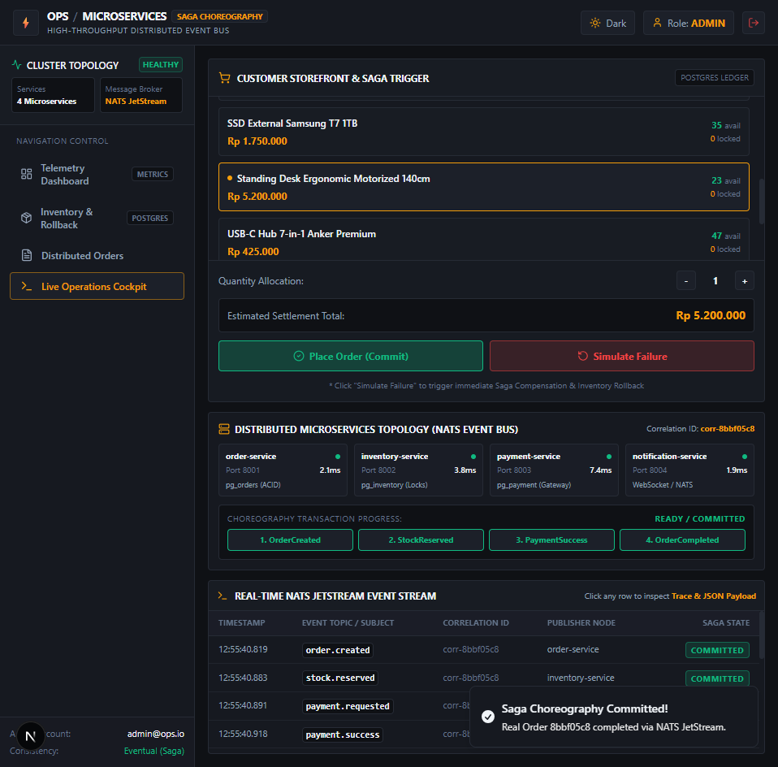
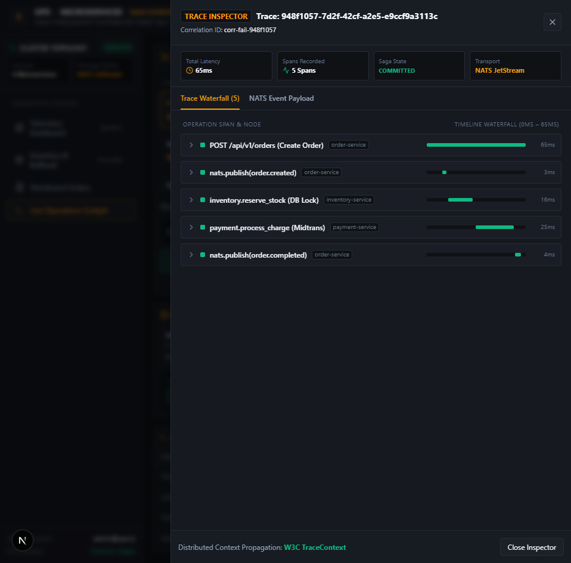
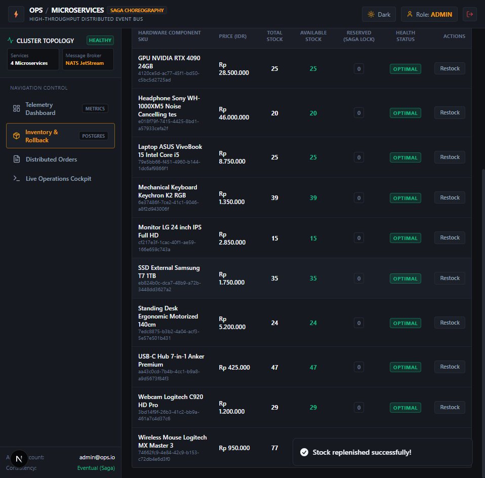
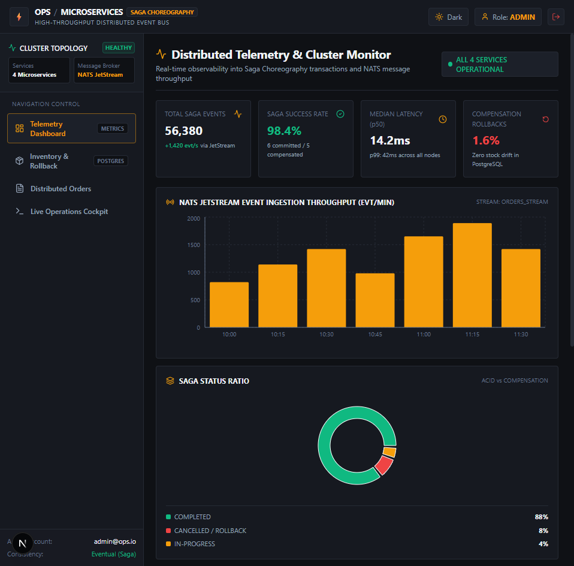

# Order Processing System - Frontend (Web Next.js)

Web application modern Next.js 16 untuk **Customer** dan **Administrator** pada platform **Sistem Pemrosesan Pesanan Terdistribusi Berbasis Microservices**. Mengusung tema visual **Titanium Gunmetal & Industrial Amber**, *fixed viewport layout* bebas scroll ganda, serta integrasi visualisasi **Distributed Saga Choreography** dan telemetry event streaming secara real-time yang terhubung langsung ke cluster 4 Go Microservices dan NATS JetStream.

Backend repositori: [order-processing-system_backend](https://github.com/Salman-artz/order-processing-system_backend).

---

## 📸 Antarmuka Sistem & Screenshots Preview

| Preview Antarmuka | Deskripsi Fitur & Inovasi UI |
|---|---|
|  | **Live Order Commit Flow (NATS JetStream)**<br/>Transaksi nyata multi-service: `order-service` mendispatch `order.created`, `inventory-service` mengunci stok di PostgreSQL, dan `payment-service` memproses pembayaran hingga status `COMPLETED` dalam 26ms. |
|  | **Real-Time Saga Compensatory Rollback**<br/>Simulasi kegagalan pembayaran: NATS mempublikasikan `payment.failed`, memicu transaksi kompensasi otomatis pada `inventory-service` untuk merestore stok (*lock released*) dan membatalkan pesanan. |
|  | **Distributed Trace Waterfall & Raw JSON Payload**<br/>Drawer telemetri interaktif untuk inspeksi rincian span latensi per mikroservis, trace ID, correlation ID, dan payload event mentah NATS JetStream. |
|  | **Distributed Orders Registry (PostgreSQL Audit)**<br/>Audit log database persisten lintas transaksi terdistribusi yang mencatat status final `COMPLETED` dan `CANCELLED` secara deterministic. |
|  | **Saga Execution Timeline UI**<br/>Visualisasi alur langkah transaksi terdistribusi, durasi latensi per span, serta penanganan kompensasi rollback inventaris otomatis. |
|  | **PostgreSQL Inventory Ledger & Stock Isolation**<br/>Pemisahan *Available Stock* vs *Reserved Stock (Saga Locks)* dengan penanganan race condition berbasis transaksi atomik PostgreSQL. |
|  | **Real-time Order Monitoring Dashboard**<br/>Konsol observabilitas terpusat: status 4 microservice, metrik throughput event NATS JetStream, dan rasio keberhasilan Saga. |
|  | **Login Mode Terang (Light Mode)**<br/>Antarmuka berstandar enterprise dengan palet Titanium Canvas dan tipografi monospace berdensitas tinggi. |
|  | **Login Mode Gelap (Dark Mode)**<br/>Palet Titanium Gunmetal & Industrial Amber dengan rasio kontras tinggi dan telemetry metadata status cluster. |

---

## 🏛️ Frontend Clean Architecture & Modular Domain Services

Seluruh komponen UI sepenuhnya terpisah dari layer data fetching dengan menerapkan **Modular Domain Services Layer** (`src/services/` & `services/`):
- `services/product.service.ts`: Abstraksi pengelolaan katalog produk, stok available vs reserved, dan mutasi restock.
- `services/order.service.ts`: Abstraksi pembuatan order normal, simulasi failure rollback, dan audit timeline Saga.
- `services/saga.service.ts`: Abstraksi telemetry NATS JetStream event stream, kesehatan node cluster, dan OpenTelemetry trace waterfall.
- `services/auth.service.ts`: Abstraksi autentikasi JWT, decoding token, dan sesi pengguna.

Komponen halaman memiliki **0 direct fetch/axios** dan sepenuhnya mengonsumsi API melalui service kontrak domain yang *testable* dan *decoupled*.

---

## 🎨 Desain Sistem: Titanium Gunmetal & Industrial Amber
- **Background Utama**: Titanium Gunmetal (`#0F1115`) pada Dark Mode dan Canvas Warm White (`#F8F9FA`) pada Light Mode.
- **Borders & Partisi**: Garis batas tipis (*hairline borders*) solid tanpa gradient dekoratif berlebih.
- **Aksen Amber Disiplin**: Warna amber (`#F59E0B`) hanya muncul ketika ada informasi penting yang butuh perhatian (warning, in-progress, state selection).
- **Semantik Status Terstandar**:
  - Hijau (`#10B981`) untuk Commit / Keberhasilan transaksi
  - Merah (`#EF4444`) untuk Rollback / Kegagalan / Kompensasi
  - Amber (`#F59E0B`) untuk Pending / In-flight / Stock Locks
  - Slate (`#64748B`) untuk metadata teknis netral

---

## 🛠️ Tech Stack Frontend

| Area | Teknologi | Keterangan |
|---|---|---|
| **Framework** | Next.js 16 (App Router) | High-performance React 19 architecture |
| **Bahasa** | TypeScript | Strict type checking & zero `any` leakage |
| **Styling** | Tailwind CSS v4 & Lucide Icons | Solid enterprise UI, responsive full-width |
| **State & Caching** | TanStack Query v5 & Zustand | Reactive client state & async cache invalidation |
| **Trace Inspector** | OpenTelemetry Waterfall Drawer | Latency breakdown & raw JSON payload viewer |
| **Charts** | Recharts | Throughput bar chart & Saga distribution donut |
| **Testing & Quality** | Playwright E2E Test Suite | Automated end-to-end user journey verification |

---

## 🚀 Menjalankan Frontend Secara Lokal

```bash
# 1. Install dependencies
npm install

# 2. Jalankan development server
npm run dev

# 3. Jalankan automated build check
npm run build
```
